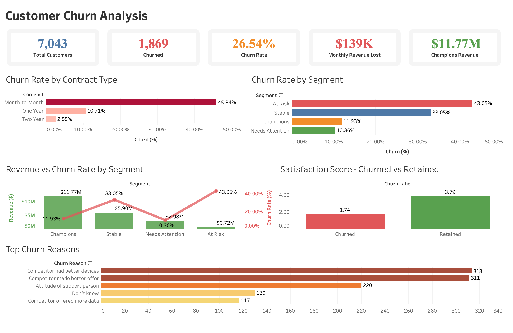

#  Customer Churn Analysis

##  Project Overview

This project analyzes customer churn behavior in a telecom company using Python, Machine Learning, and Tableau. The goal was to identify churn patterns, understand revenue impact, and build predictive models to support customer retention strategies.

---

#  Dataset

* **Source:** [IBM Telco Customer Churn (v11.1.3+)](https://community.ibm.com/community/user/businessanalytics/blogs/steven-macko/2019/07/11/telco-customer-churn-1113), a sample dataset from IBM Cognos Analytics
* **Size:** 7,043 customers, 58 columns (demographics, services, billing, satisfaction, churn label and reason)
* **File:** `dataset/processed/customer_churn_cleaned.csv`

---

#  Tools & Technologies

* Python
* Pandas
* NumPy
* Matplotlib
* Seaborn
* Scikit-learn
* Tableau
* Jupyter Notebook
* Git & GitHub

---

#  Key Analysis

* Customer churn analysis
* Revenue loss analysis
* Customer segmentation
* Satisfaction score analysis
* Churn reason analysis
* Predictive modeling using Machine Learning

---

#  Machine Learning Models

* Logistic Regression
* Random Forest Classifier

### Model Performance

| Model | Accuracy | Recall (Churn) | ROC-AUC |
|---|---|---|---|
| Logistic Regression | 79.21% | 86.10% | 0.894 |
| Random Forest | 82.04% | 83.42% | 0.902 |

Baseline (always predict "No Churn"): 73.5% accuracy. Top predictors: tenure, number of referrals, and two-year contracts.

### Avoiding Data Leakage

`SatisfactionScore` perfectly separates churners in this dataset: every customer scoring 1 or 2 churned, and no customer scoring 4 or 5 did. It was recorded alongside the churn outcome, so it would not be available when predicting churn ahead of time. Including it inflated accuracy to about 93%. I excluded it from the model, along with `ChurnScore`, `ChurnCategory`, `ChurnReason`, and `CustomerStatus`.

---

#  Key Insights

* Identified a **26.54% churn rate** across 7,043 customers
* Churned customers take about **$139K in monthly recurring revenue**, roughly **$1.67M a year**
* **Month-to-month** customers churn at **45.84%**, about 18x the rate of two-year contracts (2.55%)
* **At Risk** customers (short tenure, few services) churn at **43.05%**
* **Champions** (long tenure, many services) bring in **$11.77M, 55% of lifetime revenue**
* Churned customers had much lower satisfaction (**1.74 vs 3.79**, p < 0.0001)
* **Competitors** drove **45%** of churn: better devices, better offers, and more data

---

#  Tableau Dashboard

**[View the interactive dashboard on Tableau Public](https://public.tableau.com/app/profile/goutham.mantena/viz/Customer_churn_analysis_17781846819260/Dashboard1)**

[](https://public.tableau.com/app/profile/goutham.mantena/viz/Customer_churn_analysis_17781846819260/Dashboard1)

---

#  Project Structure

```
customer-churn-analysis/
├── dataset/processed/customer_churn_cleaned.csv
├── notebook/customer_churn_analysis.ipynb
├── dashboard/customer_churn_analysis.twbx
├── images/
├── requirements.txt
└── README.md
```

---

#  How to Run

```bash
git clone https://github.com/GouthamMantena/customer-churn-analysis.git
cd customer-churn-analysis
pip install -r requirements.txt
jupyter notebook notebook/customer_churn_analysis.ipynb
```

Run all cells from top to bottom. Open the dashboard with Tableau Desktop or Tableau Public.

